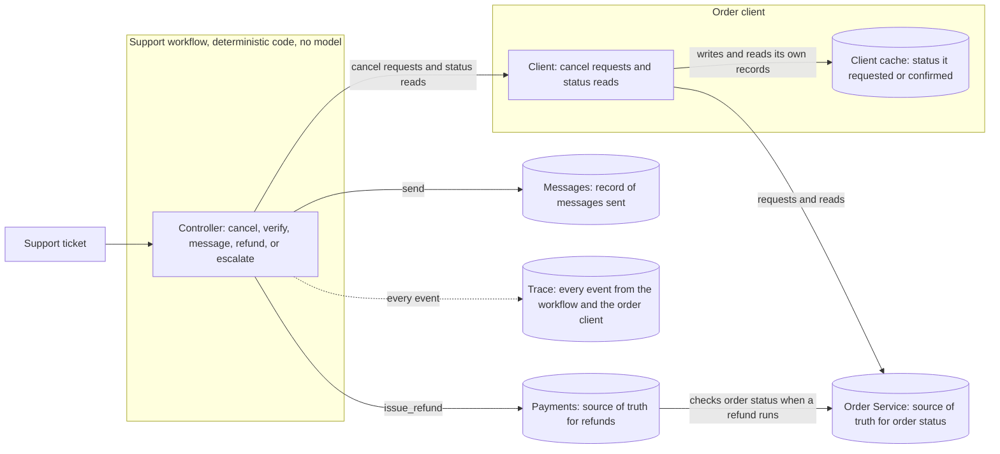
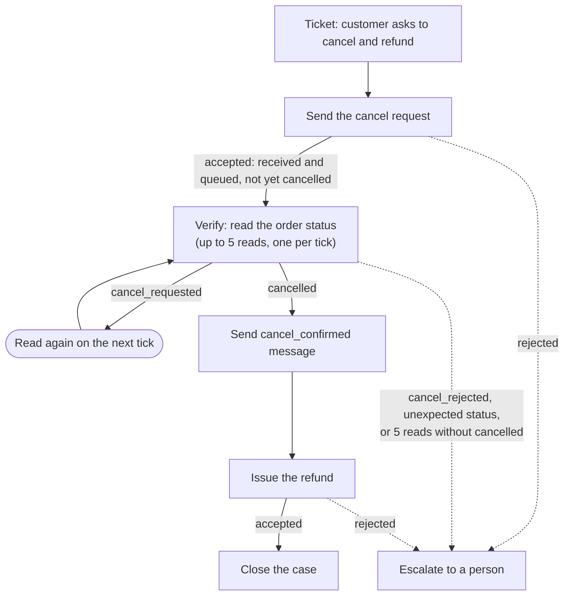

# The Cancellation That Verified Itself

The workflow has parts also found in AI agent systems: a ticket to act on, tools that interact with other systems, decisions about what to do next, and a trace of what happened. In an LLM-powered agent, a language model may make some decisions, while ordinary code handles others. Here, plain code makes the decisions so every student can reproduce and investigate the same behavior.

TechNova's support workflow takes a ticket, cancels an order, checks what happened, messages the customer, and then refunds or escalates. TechNova is a fictional company, and this incident is fictional. Set aside about 65 to 70 minutes.

## Who this is for

You need basic Python, Git, a terminal and pytest assertions, plus a basic understanding of APIs.

## What you'll practice

Compare what a system believed with what its records show, step by step, and find the first place they disagree.

## The system

| Component | Responsibility | Source of truth? |
| --- | --- | --- |
| Order Service | Owns order status. A cancel request is `accepted`, meaning received and queued. The scenario then moves the order to `cancelled`, or to `cancel_rejected` and then `shipped`, at offsets after the accepted request. | Yes, for order status |
| Order client cache | The client's own record of the status it most recently **requested** or **confirmed**, stated by its `basis` field. Written when a request is accepted, refreshed whenever the client reads the Order Service. | No |
| Payments | Issues refunds. Refuses any refund unless the Order Service says `cancelled` at the moment the refund runs. Refuses duplicates. | Yes, for refunds |
| Messages | Sends customer messages and records what was sent. | Yes, for messages sent |
| Support workflow | Ticket, cancel, verify (a bounded loop of up to five reads), message the customer, refund, or escalate. Deterministic. | No (its own notes) |



## What the workflow is supposed to do



Accepted means the cancellation request was received and queued. It does not mean the order is cancelled. The workflow must not send a cancellation confirmation or issue a refund until the order is cancelled.

## Ticks

A tick is this lab's stand-in for time. One workflow step runs at one tick, and the same commands produce the same trace on every run. A short sample, the ticket and the cancel only:

```
SEQ  STEP  TICK  KIND         DETAIL
1    1     1     ticket       SUP-3301
2    2     2     tool         cancel_order accepted CR-4517-1
```

SEQ numbers individual trace events. Use it with `show`. STEP counts the workflow actions that have run. One step can record multiple events, so SEQ can increase faster than STEP. TICK is the lab's simulated clock. It advances once per workflow step, so STEP and TICK have the same number in this lab. Use TICK when comparing the trace with `world`.

## Your assignment

TechNova's support workflow cancels orders and refunds customers. Since Tuesday the Payments service has rejected refund attempts from the workflow ("order not cancelled"). The customer for ORD-4517 was told their order was cancelled and a refund was on its way. The order shipped and no refund arrived. The team lead thinks the workflow's decision step is at fault and wants it rewritten. The workflow uses no language model.

The Payments refund rule must stay as it is.

Do the Setup section near the end of this page first.

## What to do

1. Run `python lab.py check`.
2. Run `python lab.py run ORD-4517`, then `trace` and `world` for that order.
3. Run `python lab.py run ORD-4520` and compare it with ORD-4517.
4. Write INCIDENT sections 1 and 2 before changing code. `trace`, `show`, and `world` rerun the scenario using the current code, so after your fix, their output may change. Record the original evidence first.
5. Complete the regression test and see it fail.
6. Make the smallest change that addresses what you found.
7. Run `python lab.py test` and `python lab.py verify`.
8. Finish the rest of INCIDENT if you want to.
9. Run `python lab.py bundle`.

## Rules

Do not change protected files. `python lab.py verify` reports it when one of them differs from the manifest. Protected files are `lab.py`, `lab_manifest.json`, `orderdesk/__init__.py`, `orderdesk/acceptance.py`, `orderdesk/bundle.py`, `orderdesk/clock.py`, `orderdesk/engine.py`, `orderdesk/messages.py`, `orderdesk/order_service.py`, `orderdesk/payments.py`, `orderdesk/scenarios.py`, `orderdesk/trace.py`, `scenarios/ORD-4517.json`, `scenarios/ORD-4520.json`, `scenarios/ORD-4523.json`, `tests/lab_helpers.py`, and `tests/test_backend_invariant.py`.

The Payments rule must stay.

## Using AI tools

You may use AI for incidental technical help, such as environment or setup issues, terminal or path problems, Python syntax, understanding error messages, and editor or tool usage.

Please do not use AI to perform the core diagnosis for you. Questions such as "Find the bug in this workflow," "What should I change?," "What is the correct fix?," or "Why is the refund rejected?" remove the reasoning this lab is designed to practice.

## Reading the evidence

| Command | What it shows | Exit |
| --- | --- | --- |
| `check` | Python 3.12 or newer, pytest importable, three scenarios load, one run completes. Git and integrity are warnings. Ends with `Ready. Next: python lab.py run ORD-4517`. | 0 ready, 1 not ready |
| `run <order or all>` | Writes `runs/`. Prints messages sent, refunds, and any escalation reason. | 0 finished, 1 could not run, 2 unknown order |
| `trace <order> [--full]` | `SEQ STEP TICK KIND DETAIL` for a fresh run. `--full` prints raw JSON lines. | 0, or 2 for a bad order |
| `show <order> <seq>` | One event as JSON, including the record on a read or a cache write. | 0, or 2 when `seq` is out of range |
| `world <order>` | Order Service history, status at each tick, the Payments log, the ledger, and messages sent. | 0, or 2 for a bad order |
| `test` | `pytest -q tests`. A fresh tree exits 1 because the two TODO tests stop on purpose. | pytest's code |
| `verify` | V1 to V5, each `PASS` or `FAIL`, then `Integrity:` and `Result:`. | 0 only when every check passes |
| `bundle` | Environment, your changes, automated results, and your incident claims. | always 0 |

## What verify checks

| Check | Meaning |
| --- | --- |
| V1 | Customer messages and refund attempts happen only while the order is cancelled |
| V2 | Refunds only for cancelled orders |
| V3 | ORD-4520 and ORD-4523 are each refunded exactly once |
| V4 | ORD-4517 ends escalated, with no cancel_confirmed message and no refund attempt |
| V5 | The Payments rule still holds |

## The regression test

`tests/test_cancellation_evidence.py` uses `run_scenario(order)` from `tests/lab_helpers.py`. The result has `.events` and `.world`. `world.status_at(tick)`, `world.messages`, and `world.payments_log` are the records for that run.

The worked example is already filled in and passes: the cancel response for ORD-4517 is `accepted`.

TODO 1: For every `cancellation_verified` decision, the `status_read` event named by its `based_on_seq` must have a result equal to `world.status_at(tick)` at that read's tick. Check ORD-4517 and ORD-4520. The test starts with `pytest.fail(...)` until you replace that call.

TODO 2: ORD-4517 has no `cancel_confirmed` message and no Payments log entry. The test starts with `pytest.fail(...)` until you replace that call.

## The incident report

Write in `INCIDENT.md`. No section has to be correct for you to submit. Completing the lab means a correct diagnosis and a fix that passes `verify`; that is the goal, not the entry requirement.

Sections 1 and 2 are needed to submit. Any answer counts. Sections 3 to 6 are optional.

Section 2 asks for the first unsupported claim: the earliest point where the workflow treated something as true and acted on it, but the system records at that same tick do not support the claim.

## Where things are

| Path | What it is |
| --- | --- |
| `lab.py` | The lab commands |
| `orderdesk/` | The components in the diagram |
| `orderdesk/wiring.py` | How the components are connected |
| `scenarios/` | ORD-4517, ORD-4520, and ORD-4523 |
| `tests/test_cancellation_evidence.py` | The regression test you complete |
| `INCIDENT.md` | Where you write your findings |
| `HINTS.md` | Three hints |
| `AFTER_YOU_FINISH.md` | Read this after you have run `bundle` |
| `CHANGELOG.md` | Versions 1.0, 1.1, and 1.2 |
| `LICENSE` | MIT license |

## Setup

You need Python 3.12 or newer and Git. `uv` is the recommended way to run the lab. It can install Python for you. You can use pip and a virtual environment instead. Run the commands in this folder.

### uv

Check the tools.

PowerShell:

```powershell
git --version
uv --version
```

Command Prompt:

```bat
git --version
uv --version
```

macOS or Linux:

```bash
git --version
uv --version
```

If both commands print a version, continue. You do not need to install Python yourself when using uv.

If you still need Git, use https://git-scm.com/downloads.

uv for Windows PowerShell:

```powershell
powershell -ExecutionPolicy ByPass -c "irm https://astral.sh/uv/install.ps1 | iex"
```

uv for Windows Command Prompt:

```bat
powershell -ExecutionPolicy ByPass -c "irm https://astral.sh/uv/install.ps1 | iex"
```

uv for macOS or Linux:

```bash
curl -LsSf https://astral.sh/uv/install.sh | sh
```

Close and reopen your terminal after installing uv. Then run the version checks again.

In this folder:

```bash
uv run python lab.py check
```

The first run may take a minute or two while uv prepares Python and the dependencies. You're ready when the output ends with `Ready.`

### pip

On Windows PowerShell:

```powershell
git --version
python --version
```

On Windows Command Prompt:

```bat
git --version
python --version
```

On macOS or Linux:

```bash
git --version
python3 --version
```

Confirm Python reports 3.12 or newer, then continue. On Windows, if `python` is not found, try `py --version`.

Create a virtual environment (a `.venv` folder that holds this lab's packages), activate it, install the dependencies, and check the lab.

PowerShell:

```powershell
python -m venv .venv
.venv\Scripts\Activate.ps1
python -m pip install -r requirements.txt
python lab.py check
```

If PowerShell says running scripts is disabled, run `Set-ExecutionPolicy -Scope Process -ExecutionPolicy Bypass`, then run the `Activate.ps1` command again. That setting lasts only for the current terminal window.

Command Prompt:

```bat
python -m venv .venv
.venv\Scripts\activate.bat
python -m pip install -r requirements.txt
python lab.py check
```

If `python` is not found, use `py -m venv .venv` for the first command.

macOS or Linux:

```bash
python3 -m venv .venv
source .venv/bin/activate
python -m pip install -r requirements.txt
python lab.py check
```

While the environment is active, your prompt starts with `(.venv)`. Each time you open a new terminal, run the activate command again before you use the lab.

With pip, the commands in this README already use `python lab.py`. If you use uv, put `uv run` in front of `python`, as in the check command above.

If you already use Conda or an IDE interpreter, select a Python 3.12 or newer environment, run `python -m pip install -r requirements.txt` in this folder, then `python lab.py check`.

## If you get stuck

Open `HINTS.md` and read one hint at a time.

## Submitting

Run `bundle` and paste the whole output, whatever state your work is in. Fill in INCIDENT sections 1 and 2 first. Your best reasoning counts, even if it turns out to be wrong.

## Partial work

Running out of time is fine. Fill in sections 1 and 2, run `bundle`, and submit what you have.

## Setup problems

If `check` fails, run `bundle` anyway and submit what it prints. If Python itself will not run, copy the commands you tried and their full error output. If you are doing this lab as part of a study, the submission form has a place for setup problems.

## After you finish

Read this after you have run `bundle`: [AFTER_YOU_FINISH.md](AFTER_YOU_FINISH.md).
